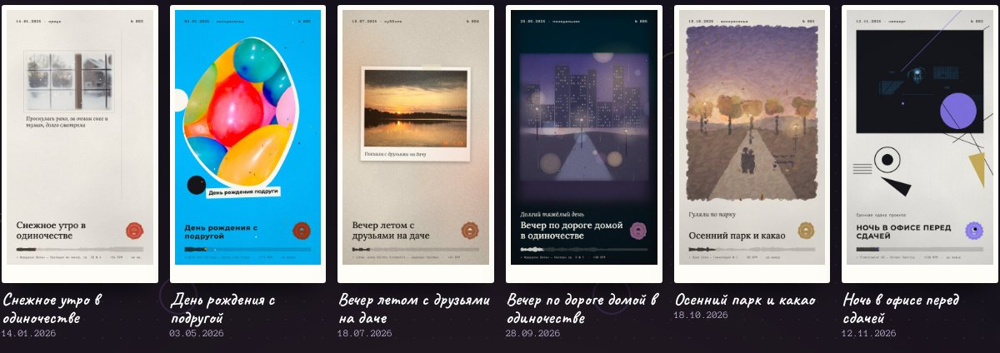

# Послевкусие — дневник атмосферы дня

Прототип для кейса ArtTech «Make the Invisible Visible» (онлайн-этап 19–22 ноября 2026).

Человек пишет, как прошёл день, добавляет фотографии и песню. «Послевкусие» превращает это в вертикальное видео-воспоминание 9:16 под фрагмент этой песни и кладёт его в папку дня с придуманным названием: «Осенний парк и какао», «Ночь в офисе перед сдачей». Папки складываются в дневник-архив.

Всё работает в браузере, без сервера, ключей и внешних библиотек. Приложение — один файл `index.html`.



## Для жюри

- **Прототип:** https://khaan011.github.io/hackaton-genezis/ — откройте в Chrome, Edge или Safari, при первом открытии загрузится демо-дневник.
- **Код:** этот репозиторий; сборка — `python3 build.py`, проверки — `npm test`.
- **Презентация:** [docs/presentation.pdf](docs/presentation.pdf) (или [HTML-версия](docs/presentation.html), листать ← →).
- **Запуск у себя:** `sh start.sh` (macOS/Linux) или `start.bat` (Windows) — откроется http://localhost:8765.
- **Видео и презентация:** ссылки в документе сдачи (Google Docs).
- **Быстрее всего:** кнопка **«▶ Экскурсия»** в архиве — 40 секунд по настоящему интерфейсу со звуком. В форме дня — **«✦ Попробовать на примере»**: фото и песня подставятся сами, если под рукой нет своих.

> Демо-дневник в `demo/diary.zip` сейчас собран из **синтетических** дней: снимки нарисованы скриптом `test/gen_photos.py`, песни синтезированы `test/gen_music.py`. Это сделано для проверки всех шести режимов без чужих материалов. Перед сдачей мы заменяем его экспортом настоящих дней команды.

## Что сделано за хакатон (19–22 ноября 2026)

- Идея и визуальная система: шесть осей настроения → шесть художественных режимов с постоянной рамкой дневника.
- Анализ текста, фото и песни прямо в браузере, без серверов и внешних библиотек.
- Рендер шести режимов, видео 9:16 под фрагмент песни, папка дня в ZIP, архив и лента.
- Интерфейс «послевкусия»: цвета дня остаются в дневнике, полоса цветов архива, обложки-снимки с 3D-наклоном, анимированная печать при сборке.
- Проверка жюри-агентом и исправления по ней: телефонная шапка, наложение фигур на подписи, читаемость даты, честная уверенность лада, «домой» ≠ «дома», нумерация после импорта, проверки в тестах и CI.

## Запуск

- **Быстро:** откройте `index.html` в Chrome, Edge или Safari.
- **Надёжнее (как у жюри):** запустите `python3 -m http.server 8000` в папке с `index.html` и откройте `http://localhost:8000`.
- **Ссылка для сдачи — GitHub Pages:**
  1. Положите `index.html` в корень репозитория.
  2. Откройте Settings → Pages → Deploy from a branch → `main` / `root`.
  3. Через минуту прототип откроется по адресу `https://<логин>.github.io/<репозиторий>/`.

## Демо-дневник для жюри

Дни хранятся в браузере того, кто их создал. Чтобы жюри сразу увидело ваши дни:

1. Создайте 3–7 настоящих дней. В архиве нажмите **«Экспорт дневника»**.
2. Положите полученный архив рядом с `index.html` как `demo/diary.zip`.
3. При первом открытии (когда архив пуст) приложение само загрузит этот дневник и покажет уведомление.

Тестовый дневник из шести синтетических дней можно загрузить кнопкой «Импорт дневника».

## Как пользоваться

1. **«Записать день»:** дата, текст о дне, 1–8 фото, песня.
   - Песню лучше дать файлом MP3/M4A/WAV — по нему работает полный аудиоанализ.
   - Можно дать ссылку (YouTube, Spotify, Яндекс Музыка, SoundCloud, Apple Music). Тогда характер песни задаётся кнопками, а исполнителя система ищет в своём словаре.
2. **«Собрать воспоминание».** Система:
   - читает текст;
   - смотрит на свет и цвет фото;
   - слушает песню;
   - выбирает художественный режим и рисует страницу.
3. **Страница дня:**
   - проигрывание с музыкой;
   - «Почему день выглядит так» — каждое решение с причиной;
   - ползунки «Поправить ощущение»;
   - другое название;
   - озвучка голосом, подобранным правилами, или своим голосом;
   - видео 1080×1920;
   - «Скачать папку дня» — ZIP с записью, фото, фрагментом песни, видео, обложкой, озвучкой и объяснением.
4. **Архив:**
   - «Папки» — сетка дней;
   - «Лента» — все дни рядом, для проверки визуальной системы.

## Видео-рассказ по записи дня

- **Каждая фраза — своя сцена.** Дневник разбирает запись на моменты («Утром гуляли с подругой по парку» → «Пили какао на скамейке» → «Вечером шёл дождь» → «Я шла домой одна») и дорисовывает под каждый сцену: место, время суток, погоду, предметы и людей. Погода начинается с того момента, когда о ней сказано; люди остаются в кадре, пока текст их не сменит.
- **Фото — референс.** Из ваших снимков берутся палитра и свет; сами сцены нарисованы по словам и проходят через художественный режим дня (мазки Моне, плакат Кандинского, плёнка, вырезки Матисса…). Переключатель «✦ Сцены / Вместе / Мои фото» на странице дня; при 3 и более фото по умолчанию — «Вместе».
- **Текст не висит всё видео.** У каждой сцены одна короткая реплика: появляется, держится и уходит до склейки. Название дня — только в начале и в финале.
- **Песню не нужно скачивать.** Режим «🔍 Найти»: поиск по исполнителю или названию в Apple Music и Deezer, ▶ — послушать, выбор — и дневник сам анализирует 30-секундный фрагмент (темп, громкость, лад), подставляет исполнителя, название и год. На iPhone первым идёт Deezer (Apple там перенаправляет поиск в приложение «Музыка»). Файл и ссылка — по-прежнему доступны.

## Интерфейс: послевкусие в самом дневнике

- **Цвет дня остаётся.** Открытый день окрашивает весь интерфейс цветами своих фото и акцентом режима: мягкое свечение фона, шкалы осей, отметки объяснений, тень кадра. После возвращения в архив оттенок держится приглушённо — буквальное «послевкусие» дня.
- **Цвета дневника.** Над архивом — полоса, где каждый день представлен градиентом из своей палитры по порядку дат; клик открывает день.
- **Снимки на столе.** Обложки лежат с лёгким наклоном, раскладываются по одной при открытии архива, а под курсором наклоняются в 3D и ловят блик.
- **Печать дорисовывается.** Во время сборки круг печати дня прорисовывается по мере готовности, а шаги «читаю запись → смотрю на свет → слушаю песню → рисую страницу» отмечаются по очереди.
- **Сначала телефон.** Нижняя панель под большим пальцем: Дневник · Лента · **＋ Записать** · Экскурсия · О системе. Форма — три шага «Запись · Фото · Песня» с отметками готовности и кнопкой «Собрать», которая всегда под рукой; фото и песня выбираются прямо из галереи и файлов. Страница дня — кадр почти на весь экран: касание ставит на паузу, **свайп листает соседние дни** (на компьютере — стрелки ‹ › и клавиши ← →), быстрые кнопки «Почему так · Поправить · Папка дня».
- **Экскурсия для жюри.** Восемь шагов по живому интерфейсу: архив → день со звуком → оси → объяснения → контрастный день → тюнинг → лента → «ваша очередь». Можно листать вручную или закрыть по Esc.
- **Пример в один клик.** Форма заполняется одним из демо-дней; поменяйте пару слов и сравните результат.
- **Доступность.** Видимый фокус для клавиатуры, ссылка «К содержимому», `aria-live` для уведомлений, учёт `prefers-reduced-motion`.

## Визуальная система (кратко)

**Постоянное для всех дней:**
- формат 9:16, поля 72 px, бумага с волокнами;
- дата и номер страницы сверху, название снизу;
- «печать дня» — круг, контур которого нарисован громкостью самой песни;
- «дорожка дня» — линия громкости песни внизу.

**Шесть режимов** включаются по осям настроения (энергия, тон, тепло близости, погода, плотность событий, ностальгия):

| Режим | Когда | Приём |
|---|---|---|
| Свет Моне | спокойный светлый тёплый день | мазки по направлению контуров, свет «дышит» с музыкой |
| Композиция (Кандинский) | напряжённый, собранный | сетка, плакатные тона, геометрия на доли песни, склейки в такт |
| Ма | тихий, пустой, одинокий | пустая бумага, маленькое фото, линия, красная печать, паузы |
| Плёнка | ностальгия, лето, друзья | отпечатки стопкой, зерно, ореол, засветки, оранжевая дата |
| Вырезки (Матисс) | радость, праздник, люди | фото в живых формах, бумажные водоросли подпрыгивают в такт |
| Ноктюрн (Уистлер, Ротко) | ночь, дождь, тяжёлый день | цветовые поля, кадр сквозь мокрое стекло, один тёплый свет |

**Главное правило:** погода красит тени, люди красят свет.

**Остальные правила:**
- **Темп песни → длина кадра:** 8, 4 или 2 доли.
- **Громкость в каждый момент → свет.**
- **Лад и плотность событий → воздух вокруг фото.**
- **Слова → детали в кадре:** листья, снег, дождь, огни, конфетти.
- **Название папки:** 3–7 слов, как подпись на обороте фотографии.

Полное описание — в разделе «Как это работает» внутри приложения.

## Сборка из исходников

```
python3 build.py      # собирает build/index.html со встроенными шрифтами
cp build/index.html index.html   # или: npm run build
```

Исходники в `src/`:

| Файл | Что делает |
|---|---|
| `util.js` | числа, цвет, даты |
| `lexicon.js` | словари: настроение, погода, места, люди, формы слов для названий, жанры и исполнители |
| `text.js` | разбор записи |
| `title.js` | названия папок |
| `image.js` | палитра k-средних в Lab, свет, контраст, точка интереса |
| `audio.js` | БПФ, функция атак по полосам, темп и доли, громкость, яркость, лад по профилям Крумхансла, срез MP3 по кадрам без перекодирования |
| `mood.js` | сведение в оси настроения, выбор режима, параметры, объяснения |
| `seal.js` | печать дня |
| `render.js` | ядро рендера: тайм-лайн под темп, бумага, зерно, погода, постоянная рамка |
| `regs.js` | шесть художественных режимов |
| `player.js` | проигрывание и запись видео, исправление длительности WebM |
| `voice.js` | озвучка и запись голоса |
| `store.js` | IndexedDB и ZIP |
| `app.js` | интерфейс |

## Проверка

В `test/`:

| Файл | Что проверяет |
|---|---|
| `node test/node_text.js` | правила текста, названия и выбор режимов на шести типичных днях |
| `node test/node_audio.js` | аудиоанализ на синтезированных песнях (60, 66, 72, 96, 120, 128 BPM) |
| `gen_music.py`, `gen_photos.py` | генерация тестовых песен и «снимков» (свои, без чужих материалов) |
| `e2e.js`, `ui.js`, `link_demo.js` | сквозной сценарий в Chrome через Playwright: шесть дней, папка дня с видео, экспорт и импорт, песня по ссылке |

Быстрый запуск:

```
npm test                 # node-проверки (с ассетами — ещё и аудио: npm run assets)
npm i && npm run serve   # в другом окне: npm run e2e
```

Скрипты выходят с ненулевым кодом, если проверка не прошла; те же проверки идут в GitHub Actions (`.github/workflows/test.yml`). Порт сервера для Playwright-скриптов задаётся переменной `PORT` (по умолчанию 8765).

## Инструменты

- **Браузерные API:** Canvas 2D, Web Audio API (декодирование и анализ), MediaRecorder и `canvas.captureStream` (видео), Web Speech API (озвучка), MediaDevices (свой голос), IndexedDB (архив), Geolocation (по желанию).
- **Погода:** Open-Meteo API, по желанию и с согласия пользователя.
- **Шрифты:** Lora, Montserrat, Anonymous Pro (SIL Open Font License), встроены в файл.
- **Разработка и тесты:** Python (numpy, Pillow, fontTools), ffmpeg, Node.js, Playwright + Chrome.
- **AI:** Claude (Anthropic) — помощь в проектировании и написании кода и текстов.

Внешних JS-библиотек нет.

## Честные ограничения

- **Аудиоанализ — оценка.** Лад иногда путается между параллельными мажором и минором. Если уверенность ниже 50%, тональность не пишется в кадре, а в объяснении помечена «лад неоднозначен, оценка». Темп редко может определиться вдвое быстрее или медленнее.
- **Песня по ссылке не анализируется:** браузер не даёт читать звук чужого сервиса. Её характер берётся из описания и словаря исполнителей.
- **Видео пишется в реальном времени** — столько секунд, сколько длится воспоминание. Формат MP4 или WebM зависит от браузера.
- **Голоса озвучки зависят от системы.** Русские голоса есть в Chrome/Edge на Windows и в Safari на macOS. Можно записать свой.
- **Названия строятся по шаблонам и словарям.** Для редких слов система выберет более общий вариант, его можно поправить вручную.
- **Оценка настроения — это подбор оформления, а не психологическая диагностика.**
- **Песни из поиска (Apple Music, Deezer) — только для прослушивания.** Их 30-секундное превью звучит в приложении и в воспоминании для личного архива, но в «папку дня» (ZIP) не кладётся: вместо файла — ссылка на трек. Условия сервисов разрешают превью только слушать.
- **Сцены дорисованы по словам, а не по снимкам.** Если у дня 3 и больше фото, по умолчанию включён режим «Вместе»: ваши снимки чередуются со сценами. Переключатель «Сцены / Вместе / Мои фото» — на странице дня.
- **Из песни хранится только фрагмент**, который звучит в воспоминании.
